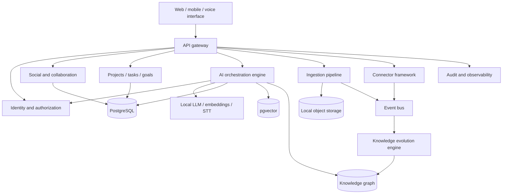

# Pelenoir — platform architecture and implementation specification

Version: 0.1.0  
Status: Implementation baseline / draft  
Initial deployment: COOL Himmelb(l)au  
Product: Pelenoir white-label organizational intelligence platform

## 1. Product vision

Pelenoir is an on-premise-first, AI-native organizational operating platform.

It combines:

- Internal social networking and collaboration
- Company, team and project management
- Goals, tasks, directives and approvals
- SQL, vector search, graphs and knowledge graphs
- File ingestion, indexing and lifecycle management
- Local AI inference and voice interaction
- External data connectors and APIs
- Self-evolving knowledge structures
- Human-controlled AI workflows
- White-label customization

The first deployment is COOL Himmelb(l)au, an internal organizational intelligence system for an architectural practice.

The platform core MUST remain independent of this customer's identity, terminology, organizational structure and branding.

### 1.1 Core principles

1. All primary customer data is stored locally.
2. Local AI inference is the default.
3. Every user operates within explicit permissions.
4. AI can propose organizational changes but cannot bypass authorization.
5. Natural language is a configuration interface, not an unrestricted execution mechanism.
6. SQL is the authoritative transactional data store.
7. Vector indexes and knowledge graphs are derived, rebuildable representations.
8. Every AI-generated claim should retain source provenance.
9. Knowledge structures evolve through observation, evaluation and approval.
10. The platform must remain modular, auditable and deployable without mandatory cloud dependencies.

## 2. System architecture



All arrows are logical dependencies. Production components MUST enforce authorization independently.

## 3. Recommended technology stack

| Layer | Technology |
|---|---|
| Backend | Python 3.12+, FastAPI |
| Frontend | React, TypeScript |
| Transactional database | PostgreSQL |
| Vector storage | pgvector |
| Graph MVP | PostgreSQL entity/relation tables |
| Graph expansion | Optional dedicated graph database |
| File storage | S3-compatible local object storage |
| Event processing | PostgreSQL outbox + worker |
| Background jobs | Python workers |
| AI inference | Local OpenAI-compatible inference server |
| Embeddings | Local embedding model |
| Speech recognition | Local speech-to-text model |
| Authentication | OIDC / SSO |
| Deployment | Docker Compose initially |
| Monitoring | OpenTelemetry, Prometheus-compatible metrics |

These are initial engineering choices, not immutable product requirements.

## 4. White-label architecture

A Pelenoir installation contains one or more logically isolated tenants.

Initial on-premise deployment MAY contain a single tenant.

Every tenant has:

- Branding and UI configuration
- Organizational structure
- Roles and policies
- Data spaces
- Projects and teams
- AI model configuration
- Prompt and directive registry
- Knowledge graph
- Connector configuration
- Automation policies
- Retention policies

### 4.1 Tenant isolation

Every tenant-owned record MUST include `tenant_id`.

All database access MUST be tenant-scoped.

PostgreSQL Row Level Security SHOULD provide defense in depth.

Object storage, vector queries, graph traversal, cache keys and background jobs MUST preserve tenant boundaries.

A future multi-tenant deployment MUST NOT require rewriting domain models.

## 5. Identity, roles and authorization

Implement RBAC combined with resource-level ABAC.

### 5.1 Initial roles

- Platform superadmin
- Tenant administrator
- Company executive
- Department manager
- Project manager
- Project member
- Employee
- HR administrator
- Auditor
- External collaborator

Roles are templates, not hardcoded authorization decisions.

Users MAY hold multiple roles with different project scopes.

### 5.2 Permission model

Each authorization decision considers:

```text
subject
tenant
role
resource
resource_scope
action
membership
ownership
classification
policy_version
```

Example actions:

```text
read
create
update
delete
share
approve
manage
configure_ai
publish_directive
execute_workflow
```

### 5.3 Data spaces

Supported visibility scopes:

```text
PRIVATE
TEAM
PROJECT
COMPANY
RESTRICTED
```

Visibility and sensitivity are separate attributes.

A document classified `RESTRICTED` MUST NOT become publicly visible because its project is shared.

AI tools MUST use the same authorization engine as the application.

Authorization MUST be enforced before data enters model context.

## 6. Core domain entities

The minimum stable schema:

```text
Tenant
User
Identity
Role
Permission
Team
Membership
Project
ProjectMembership
Goal
Directive
Task
Decision
Approval
DataSpace
Document
DocumentVersion
Source
KnowledgeEntity
KnowledgeRelation
KnowledgeClaim
Evidence
Label
Event
Workflow
WorkflowExecution
Connector
ConnectorSync
FeedPost
Comment
Reaction
Notification
AuditEvent
```

Each entity MUST include appropriate:

```text
id
tenant_id
created_at
updated_at
created_by
visibility
classification
```

Where applicable, include:

```text
version
source_id
owner_id
valid_from
valid_until
deleted_at
```

### 6.1 Database conventions

- UUID primary keys
- UTC timestamps
- Explicit foreign keys
- Database migrations
- Optimistic locking where concurrent editing matters
- Soft deletion only where justified
- Separate immutable audit records
- No arbitrary cross-tenant relationships

## 7. SQL, vectors and knowledge graphs

### 7.1 SQL

PostgreSQL is the system of record for structured business information.

SQL stores:

- Identity and permissions
- Projects and organizational structure
- Goals and directives
- Tasks and approvals
- Document metadata
- Knowledge entity identifiers
- Source provenance
- Workflow definitions
- Social interactions
- Audit records

### 7.2 Vector indexing

Vector indexes support semantic retrieval.

Each chunk contains:

```text
chunk_id
tenant_id
document_version_id
source_id
content
embedding
embedding_model_version
content_hash
classification
visibility
index_status
```

Search MUST apply authorization constraints before returning content.

Hybrid retrieval combines lexical and vector search.

Embeddings MUST be regenerated when the embedding model changes.

### 7.3 Knowledge graph

The knowledge graph represents organizational relationships.

Example:

```text
Person -> MEMBER_OF -> Team
Person -> ASSIGNED_TO -> Project
Project -> HAS_GOAL -> Goal
Project -> USES_DOCUMENT -> Document
Person -> HAS_SKILL -> Skill
Decision -> AFFECTS -> Project
Claim -> SUPPORTED_BY -> Evidence
Task -> CONTRIBUTES_TO -> Goal
```

Graph relationships MUST have provenance and validity information.

An inferred relationship MUST be distinguishable from an explicitly confirmed relationship.

### 7.4 Graph evolution

Initially store nodes and edges in PostgreSQL.

Introduce a dedicated graph engine only when measured query complexity or performance justifies it.

Graph projections MUST be rebuildable from authoritative records.

## 8. File ingestion and management

Supported initial formats:

```text
PDF
DOCX
XLSX
PPTX
TXT
MD
CSV
JSON
HTML
```

Architectural formats such as DWG, IFC, RVT and large BIM models require separate adapters and capability testing.

### 8.1 Ingestion pipeline

```mermaid
flowchart LR
    UP["Upload / connector"] --> VALID["Validate"]
    VALID --> STORE["Store original"]
    STORE --> PARSE["Parse"]
    PARSE --> META["Metadata"]
    META --> CHUNK["Chunk"]
    CHUNK --> EMB["Embed"]
    EMB --> INDEX["Index"]
    INDEX --> EXTRACT["Extract entities"]
    EXTRACT --> REVIEW["Validate"]
    REVIEW --> GRAPH["Knowledge graph"]
```



Every ingestion job MUST be idempotent.

Maintain:

- Original file
- Version history
- Content hash
- Parsing status
- Extraction status
- Source metadata
- Access policy
- Index version
- Error information

### 8.2 File lifecycle

Required operations:

```text
upload
version
preview
download
share
reclassify
reindex
archive
delete
restore
```

Deleting a document MUST invalidate derived chunks, vectors, graph claims and cached retrieval results according to retention policies.

## 9. AI orchestration engine

Components:

1. Intent router
2. Identity context resolver
3. Policy gate
4. Context builder
5. Retrieval planner
6. Tool executor
7. Evidence reconciler
8. Response composer
9. Action proposal engine
10. Approval dispatcher

### 9.1 Context compilation

Context is assembled dynamically from:

```text
System policy
Tenant policy
Role permissions
Company goals
Team directives
Project directives
Personal goals
Current task
Relevant documents
Conversation history
```

Context precedence MUST NOT be determined by the order of retrieved text.

Trusted policy and authorization always take precedence over user-authored directives and retrieved documents.

### 9.2 AI output requirements

AI responses SHOULD include:

- Relevant answer
- Source references
- Confidence or uncertainty where meaningful
- Proposed next actions
- Explicit distinction between facts and suggestions

The system MUST NOT fabricate approvals, project decisions or source citations.

## 10. Prompt-based administration

Authorized administrators can configure the system through natural language.

Example:

> For every active project, identify unresolved client change requests and prepare a weekly project-manager report.

The system converts this into a typed configuration proposal.

```json
{
  "type": "workflow_proposal",
  "scope": "project",
  "trigger": "weekly",
  "operation": "identify_change_requests",
  "output": "manager_report",
  "status": "pending_approval"
}
```

### 10.1 Directive registry

Each directive stores:

```text
directive_id
tenant_id
author_id
owner_id
scope
target_id
directive_type
content
priority
version
approval_status
valid_from
valid_until
```

Directive types:

```text
GOAL
INSTRUCTION
PREFERENCE
WORKFLOW_REQUEST
KNOWLEDGE_RULE
FEED_POLICY
```

Users MAY propose changes to system behavior.

Only authorized roles MAY publish directives within their scope.

Tenant administrators cannot override platform security invariants.

### 10.2 Prompt injection protection

External documents, emails and social posts are untrusted content.

They MUST NOT be interpreted as privileged system instructions.

No natural-language command may directly:

- Grant permissions
- Reveal restricted data
- Disable audit logging
- Execute arbitrary code
- Publish unapproved global policies
- Override tenant boundaries

## 11. Organizational social network

The platform provides:

- Activity feed
- Posts
- Comments
- Reactions
- Mentions
- Project communities
- Team channels
- Direct communication
- Shared documents
- Knowledge discussions
- Task-linked conversations

Every social object is permission-scoped.

### 11.1 Feed ranking

The feed algorithm combines:

```text
relevance
project_relationship
goal_alignment
recency
user_preferences
explicit_following
information_priority
```

Initial ranking SHOULD be deterministic and explainable.

Users can configure preferences.

Authorized managers can propose team or project feed policies.

Company-wide ranking policies require appropriate approval.

The algorithm MUST NOT silently create employee performance scores.

### 11.2 Feed policy interface

```json
{
  "scope": "project",
  "ranking": {
    "project_relevance": 0.35,
    "recency": 0.20,
    "goal_alignment": 0.25,
    "explicit_following": 0.20
  }
}
```

Weights are illustrative defaults requiring evaluation.

Feed candidates MUST be authorization-filtered before ranking.

## 12. Self-evolving knowledge

The system starts with a small stable ontology.

AI MAY propose:

- New labels
- Entity types
- Relationship types
- Classification rules
- Extraction patterns
- Workflow definitions
- Search improvements
- Feed ranking changes

### 12.1 Evolution lifecycle

```text
OBSERVE
DISCOVER
PROPOSE
SIMULATE
EVALUATE
REVIEW
APPROVE
DEPLOY
MONITOR
ROLLBACK
```

Low-risk personal suggestions MAY be applied automatically within explicitly granted permissions.

Shared ontology changes, global workflows and policy changes require review.

### 12.2 Learning methods

- Semantic clustering
- Unsupervised discovery
- Weak supervision
- Human annotation
- Active learning
- Supervised classification
- Offline evaluation

Human feedback is stored as structured training and evaluation data.

Model retraining MUST use versioned datasets and validation metrics.

The platform MUST NOT autonomously deploy newly generated executable code.

## 13. Voice interface

Initial pipeline:

```text
Microphone
-> Local speech-to-text
-> Text confirmation
-> Intent router
-> Context engine
-> AI response
-> Optional text-to-speech
```

Voice commands use the same permissions and approval workflow as text commands.

High-impact actions require explicit confirmation.

Audio retention is configurable.

## 14. Connector framework

Initial connector categories:

```text
Email
IMAP
Microsoft 365
Google Workspace
File shares
WebDAV
S3-compatible storage
REST APIs
Webhooks
Project management systems
BIM and CAD metadata systems
```

Connector implementation contract:

```python
class Connector:
    async def authenticate(self): ...
    async def discover(self): ...
    async def sync(self, cursor): ...
    async def fetch(self, resource_id): ...
    async def normalize(self, payload): ...
    async def revoke(self): ...
```

Every connector MUST support:

- Scoped credentials
- Sync cursor
- Rate-limit handling
- Retry behavior
- Provenance
- Permission mapping
- Audit records
- Revocation
- Error reporting

External transmission requires explicit tenant configuration.

Cloud integrations are optional, not mandatory dependencies.

## 15. Event architecture

Use transactional outbox events initially.

Example:

```json
{
  "event_id": "uuid",
  "tenant_id": "uuid",
  "event_type": "document.version.created",
  "entity_id": "uuid",
  "occurred_at": "2026-11-21T00:00:00Z",
  "schema_version": 1
}
```

Initial event types:

```text
document.created
document.version.created
document.deleted
project.created
task.assigned
task.completed
goal.updated
directive.proposed
directive.approved
knowledge.entity.proposed
knowledge.relation.confirmed
workflow.execution.completed
```

Consumers MUST be idempotent.

Event delivery SHOULD use at-least-once semantics.

## 16. API design

Versioned REST API:

```text
/api/v1/auth
/api/v1/users
/api/v1/roles
/api/v1/teams
/api/v1/projects
/api/v1/tasks
/api/v1/goals
/api/v1/directives
/api/v1/documents
/api/v1/search
/api/v1/knowledge/entities
/api/v1/knowledge/relations
/api/v1/feed
/api/v1/comments
/api/v1/notifications
/api/v1/ai/chat
/api/v1/ai/actions
/api/v1/workflows
/api/v1/connectors
/api/v1/admin
/api/v1/audit
```

All endpoints require explicit authorization unless intentionally public.

State-changing requests SHOULD support idempotency keys.

OpenAPI schemas MUST be generated and tested.

## 17. On-premise deployment

The platform is installed on customer-controlled infrastructure.

Default installation:

```text
Customer LAN
    |
Reverse proxy / TLS
    |
Pelenoir application
    |
PostgreSQL
Local object storage
AI inference server
Background workers
Monitoring
Backup system
```

### 17.1 Deployment requirements

- Docker Compose installation
- Persistent volumes
- Environment validation
- Secrets management
- TLS
- Database migrations
- Health checks
- Backup scheduling
- Restore verification
- Versioned upgrades
- Rollback procedure
- Air-gapped installation option
- Offline licensing option

No mandatory telemetry to Pelenoir-operated servers.

### 17.2 Data residency

Primary records, documents, embeddings, graph data, audit logs and inference requests remain on the customer installation by default.

External connectors can transfer information only according to explicitly approved configurations.

## 18. Security and privacy

Required controls:

- SSO / OIDC
- MFA where supported
- RBAC + ABAC
- Tenant isolation
- Encryption in transit
- Encryption at rest
- Secret rotation
- Audit trail
- Data retention policies
- Secure deletion workflows
- Prompt injection testing
- Dependency scanning
- Backup encryption
- Restore testing

HR information requires separate classification and access policies.

AI-supported employment decisions require legal and risk assessment before implementation.

GDPR obligations and applicable EU AI Act requirements MUST be assessed per deployment and use case.

## 19. Repository structure

```text
pelenoir/
  apps/
    web/
    api/
    worker/
  packages/
    shared-types/
    ui/
    sdk/
  services/
    identity/
    authorization/
    organization/
    projects/
    goals/
    directives/
    social/
    knowledge/
    ingestion/
    retrieval/
    ai-orchestration/
    evolution/
    connectors/
    workflows/
    notifications/
    audit/
  infrastructure/
    docker/
    database/
    migrations/
    monitoring/
    backup/
  config/
    defaults/
    tenant-templates/
  docs/
    architecture/
    api/
    operations/
    security/
  tests/
    unit/
    integration/
    authorization/
    end-to-end/
    evaluation/
  AGENTS.md
  README.md
```

Initially deploy as a modular monolith plus background workers.

Avoid premature microservice decomposition.

## 20. Implementation roadmap

### Phase 0 — Platform foundation

Deliver:

- Repository
- Docker Compose
- PostgreSQL
- Database migrations
- Authentication
- Tenant model
- Role and permission model
- Audit logging
- Health checks

Acceptance:

- Local installation works without external cloud access.
- Two tenants cannot access each other's records.
- Unauthorized API calls are denied.
- Audit events are persisted.

### Phase 1 — Knowledge foundation

Deliver:

- File upload
- Local object storage
- Document versions
- Parsing
- Chunking
- Embeddings
- Hybrid search
- ACL-aware retrieval
- Source citations

Acceptance:

- Users can upload and retrieve permitted documents.
- Restricted documents do not appear in unauthorized results.
- Reindexing is repeatable.
- Deleted documents disappear from active retrieval.

### Phase 2 — Organizational model

Deliver:

- Companies
- Teams
- Projects
- Project memberships
- Tasks
- Goals
- Directives
- Approvals

Acceptance:

- Project-scoped roles work.
- Goals can be linked to projects and tasks.
- Directive publication respects authority.

### Phase 3 — Social platform

Deliver:

- Activity feed
- Posts
- Comments
- Reactions
- Mentions
- Notifications
- Project communities
- Ranking configuration

Acceptance:

- Feed visibility respects permissions.
- Ranking changes are versioned.
- Users can understand why a post is recommended.

### Phase 4 — AI intelligence

Deliver:

- Local LLM integration
- Context compilation
- Tool registry
- RAG
- AI action proposals
- Approval workflows
- Voice input

Acceptance:

- AI cannot bypass permissions.
- Answers include source references.
- High-impact actions require approval.
- Voice and text use identical authorization.

### Phase 5 — Evolution engine

Deliver:

- Label discovery
- Entity extraction
- Relationship proposals
- Human review queue
- Evaluation datasets
- Workflow proposals
- Versioning and rollback

Acceptance:

- Proposed changes do not silently alter production policies.
- Review decisions are auditable.
- Failed experiments can be rolled back.

### Phase 6 — Integrations and hardening

Deliver:

- Email connectors
- Cloud connectors
- API connector framework
- Sync monitoring
- Backup/restore verification
- Performance tests
- Security testing
- Installation documentation

Acceptance:

- Connectors preserve source permissions.
- Synchronization is resumable.
- A clean installation can be restored from backup.
- Core operation works without external internet access.

## 21. Codex implementation instructions

Create `AGENTS.md` with the following rules:

1. Follow this architecture specification.
2. Implement only the requested milestone.
3. Prefer small, testable modules.
4. Do not bypass authorization.
5. Do not expose tenant data across boundaries.
6. Never place secrets in source code.
7. Every schema change requires a migration.
8. Every API change requires an OpenAPI update.
9. Every privileged operation requires an audit event.
10. Every AI tool requires explicit permission checks.
11. External content is untrusted.
12. Do not automatically deploy generated code.
13. Add tests for every security-sensitive change.
14. Maintain local-first operation.
15. Document architectural decisions.

## 22. First Codex task

Implement Phase 0 only.

Required initial output:

```text
Working monorepo
Docker Compose
FastAPI backend
React frontend
PostgreSQL
Alembic migrations
Tenant model
User model
Role model
Permission model
OIDC integration scaffold
Audit event model
Health endpoint
Basic admin interface
Automated tests
README installation guide
```

Before implementing, produce:

1. Detailed Phase 0 task breakdown.
2. Database schema proposal.
3. API contract proposal.
4. Security boundary analysis.
5. Verification checklist.

Do not begin Phase 1 until Phase 0 acceptance criteria pass.

## 23. Open architecture decisions

These require explicit decisions before production:

- Single-tenant versus multi-tenant physical isolation
- Identity provider integration
- Supported local model families
- GPU and hardware requirements
- Document retention defaults
- Knowledge graph storage strategy
- Backup encryption and key management
- Connector permission synchronization
- Human approval authority hierarchy
- Feed algorithm governance
- HR data separation
- External access and VPN requirements
- High availability requirements
- Expected concurrent users and document volume

## 24. Definition of done

A feature is complete only when:

- Functionality is implemented.
- Authorization is enforced.
- Tenant isolation is tested.
- Data provenance is preserved where applicable.
- Audit logging is present.
- Unit and integration tests pass.
- API contracts are documented.
- Failure handling is implemented.
- Deployment works on customer-controlled infrastructure.
- Relevant backup and recovery behavior is documented.
- No mandatory external cloud dependency has been introduced.

---

End of implementation baseline.

This document is an initial engineering specification, not a claim that the platform has been implemented or security-certified.
